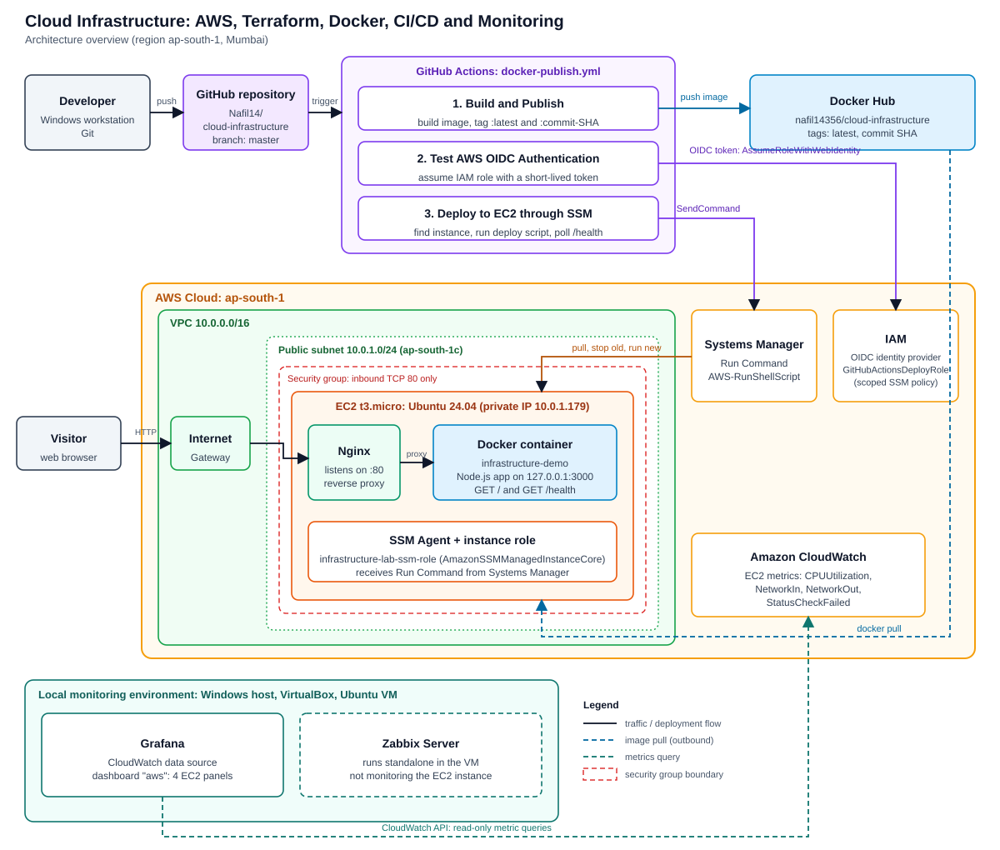
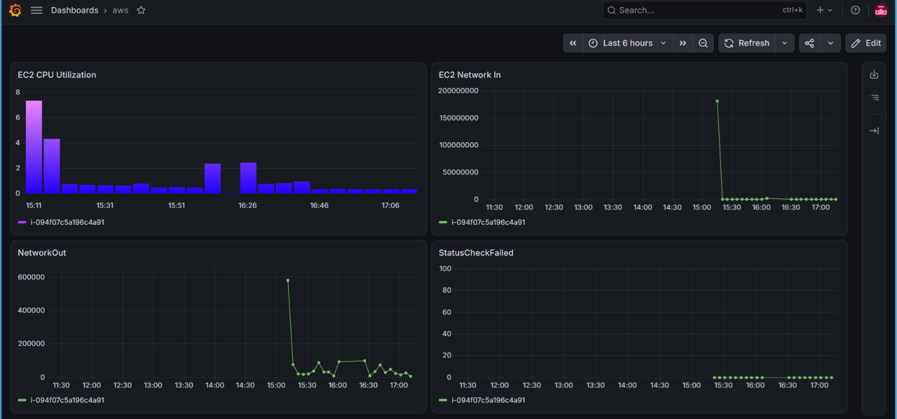
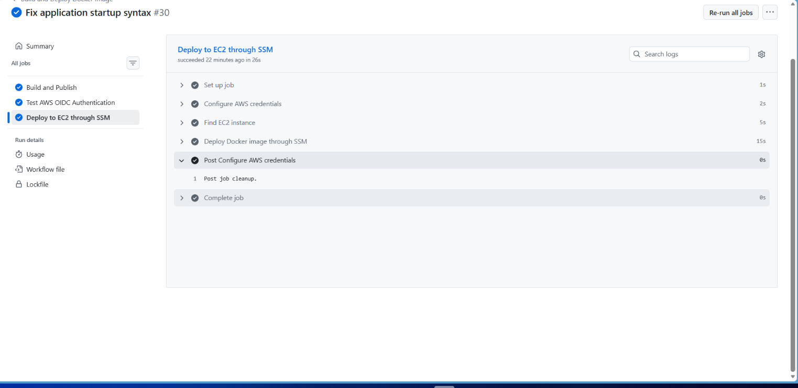

# Cloud Infrastructure: AWS, Terraform, Docker, CI/CD and Monitoring

[](https://github.com/Nafil14/cloud-infrastructure/actions/workflows/docker-publish.yml)
[](https://hub.docker.com/r/nafil14356/cloud-infrastructure)

A hands-on infrastructure project. Terraform builds the AWS environment. GitHub Actions builds a Docker image and deploys it to an EC2 instance through AWS Systems Manager. Authentication uses IAM OIDC, so no long-lived AWS keys are stored anywhere. Grafana reads EC2 metrics from CloudWatch.

I built this to practise the full path from empty AWS account to monitored, automatically deployed service. It includes the real failures I hit along the way and how I fixed them (see [Troubleshooting log](#troubleshooting-log)).



## Table of contents

- [What this project demonstrates](#what-this-project-demonstrates)
- [Architecture](#architecture)
- [Tech stack](#tech-stack)
- [Repository structure](#repository-structure)
- [How a deployment works](#how-a-deployment-works)
- [Security design](#security-design)
- [Monitoring](#monitoring)
- [Getting started](#getting-started)
- [Troubleshooting log](#troubleshooting-log)
- [Known limitations and next steps](#known-limitations-and-next-steps)
- [Evidence and screenshots](#evidence-and-screenshots)
- [Cost control](#cost-control)
- [Author](#author)

## What this project demonstrates

| Skill area | What was done |
|---|---|
| Infrastructure as Code | Terraform provisions the VPC, public subnet, internet gateway, route table, security group, EC2 instance and SSM instance role. |
| Linux administration | Ubuntu 24.04 server running Docker and Nginx, set up through EC2 user data. |
| Containers | Node.js app packaged as a Docker image and published to Docker Hub with `latest` and commit-SHA tags. |
| CI/CD | GitHub Actions workflow builds, publishes, tests AWS authentication and deploys on every push to `master`. |
| Cloud security | GitHub authenticates to AWS with OIDC and a scoped IAM role. No SSH port is open. The app container only listens on localhost. |
| Deployment automation | AWS Systems Manager Run Command pulls the new image, replaces the old container and polls `/health`. |
| Monitoring | Grafana dashboard with four EC2 panels, fed by CloudWatch. |
| Troubleshooting | Failed deployments investigated from logs, root cause found, fixed and redeployed. |

## Architecture

The diagram above shows two environments.

**AWS (region `ap-south-1`, Mumbai)**

| Component | Detail |
|---|---|
| VPC | `10.0.0.0/16` |
| Public subnet | `10.0.1.0/24` in `ap-south-1c`, routed to an internet gateway |
| Security group | Inbound TCP 80 from `0.0.0.0/0`. Outbound allowed. No SSH rule. |
| EC2 | `t3.micro`, Ubuntu 24.04, 8 GB gp3 root volume, no key pair attached |
| Instance role | `infrastructure-lab-ssm-role` with `AmazonSSMManagedInstanceCore`, so the instance registers with Systems Manager |
| Nginx | Listens on port 80, proxies to `127.0.0.1:3000` |
| App container | `infrastructure-demo`, Node.js app bound to `127.0.0.1:3000` on the host |
| Tags | `Project=cloud-infrastructure`, `Name=infrastructure-demo-app`, `Environment=lab` |

**Local monitoring environment**

A Windows machine runs VirtualBox with an Ubuntu VM. The VM hosts Grafana (connected to AWS CloudWatch) and a Zabbix Server. Zabbix runs on its own and does **not** monitor the EC2 instance.

## Tech stack

| Layer | Tools |
|---|---|
| Cloud | AWS (VPC, EC2, IAM, Systems Manager, CloudWatch) |
| IaC | Terraform |
| Containers | Docker, Docker Hub |
| CI/CD | GitHub Actions |
| Web | Nginx (reverse proxy), Node.js |
| Monitoring | Grafana, CloudWatch, Zabbix |
| OS | Ubuntu 24.04 (EC2), Ubuntu in VirtualBox (monitoring) |

## Repository structure

```text
cloud-infrastructure/
├── .github/
│   └── workflows/
│       └── docker-publish.yml    # Build, publish, OIDC test, SSM deploy
├── terraform/                    # AWS infrastructure definition
├── docs/
│   ├── architecture.svg          # Architecture diagram
│   └── screenshots/              # Evidence used in this README
├── app.js                        # Node.js application (/ and /health)
├── Dockerfile                    # Container image definition
└── README.md
```

## How a deployment works

Every push to `master` (or a manual run) starts the `docker-publish.yml` workflow. It has three jobs:

1. **Build and Publish.** Checks out the code, logs in to Docker Hub, builds the image and pushes it with two tags: `latest` and the commit SHA.
2. **Test AWS OIDC Authentication.** Requests a GitHub OIDC token and assumes `GitHubActionsDeployRole` through AWS STS. This proves the trust relationship works before any deployment happens.
3. **Deploy to EC2 through SSM.** Assumes the role again, finds the EC2 instance, then sends a Run Command (`AWS-RunShellScript`). On the instance the script:
   - pulls the commit-tagged image from Docker Hub,
   - removes the previous `infrastructure-demo` container,
   - starts the new container bound to `127.0.0.1:3000`,
   - polls `/health` and fails the job if the app does not become healthy.

A normal deployment finishes in about 26 seconds (run #30).

Health check response:

```json
{"status":"healthy","application":"Cloud Infrastructure Portfolio","author":"Nafil"}
```

## Security design

- **No long-lived AWS credentials.** The workflow requests `id-token: write` and assumes an IAM role through OIDC. The only GitHub secrets are `DOCKERHUB_USERNAME` and `DOCKERHUB_TOKEN`.
- **Trust policy is restricted.** The role can only be assumed by tokens with audience `sts.amazonaws.com` and a subject limited to this repository and the `master` branch.
- **Least-privilege deploy policy.** `GitHubEC2DeploymentSSMPolicy` allows `ssm:SendCommand` only for the specific instance and the AWS documents the deployment needs, plus the describe and command-invocation actions required to read results.
- **No SSH.** The security group has no port 22 rule and the instance has no key pair. Management goes through Systems Manager.
- **App not exposed directly.** The container is published on `127.0.0.1:3000`, so only Nginx on the same host can reach it.
- **Secrets stay out of the repo.** Terraform state, credentials, tokens and private keys must never be committed (see `.gitignore`).

## Monitoring

Grafana runs in the local Ubuntu VM with CloudWatch as a data source. The dashboard `aws` has four panels for the EC2 instance:

| Panel | Metric |
|---|---|
| EC2 CPU Utilization | `CPUUtilization` |
| EC2 Network In | `NetworkIn` |
| NetworkOut | `NetworkOut` |
| StatusCheckFailed | `StatusCheckFailed` |



Zabbix Server is installed in the same VM as a separate monitoring platform. It is not collecting EC2 metrics in this project.

## Getting started

### Prerequisites

- An AWS account and an IAM user or role that can create the resources above
- [Terraform](https://developer.hashicorp.com/terraform/install) and the AWS CLI configured for `ap-south-1`
- A GitHub repository and a Docker Hub account with an access token
- Docker (optional, for local testing)

### 1. Provision the infrastructure

```bash
cd terraform
terraform init
terraform plan
terraform apply
```

Terraform creates the network, security group, EC2 instance and SSM instance role. User data installs Docker and Nginx, pulls the application image, starts the container and configures the Nginx proxy.

### 2. Create the GitHub OIDC trust in AWS

Create an IAM identity provider:

- Provider URL: `https://token.actions.githubusercontent.com`
- Audience: `sts.amazonaws.com`

Create the role `GitHubActionsDeployRole` with a trust policy of this shape (replace the placeholders):

```json
{
  "Version": "2012-10-17",
  "Statement": [{
    "Effect": "Allow",
    "Principal": {
      "Federated": "arn:aws:iam::<ACCOUNT_ID>:oidc-provider/token.actions.githubusercontent.com"
    },
    "Action": "sts:AssumeRoleWithWebIdentity",
    "Condition": {
      "StringEquals": {
        "token.actions.githubusercontent.com:aud": "sts.amazonaws.com",
        "token.actions.githubusercontent.com:sub": "repo:<GITHUB_USER>/<REPO>:ref:refs/heads/master"
      }
    }
  }]
}
```

Attach a policy that allows `ssm:SendCommand` for the target instance and the `AWS-RunShellScript` document, plus `ssm:GetCommandInvocation`, `ssm:ListCommandInvocations` and `ec2:DescribeInstances`.

### 3. Add GitHub secrets

| Secret | Purpose |
|---|---|
| `DOCKERHUB_USERNAME` | Docker Hub login |
| `DOCKERHUB_TOKEN` | Docker Hub access token |

### 4. Deploy

Push to `master`, or run the workflow manually from the Actions tab. Then verify:

```bash
curl -i http://<EC2_PUBLIC_IP>/
curl http://<EC2_PUBLIC_IP>/health
```

The site is served over plain HTTP, so use `http://` explicitly in the browser.

## Troubleshooting log

These are real issues from building this project, kept as a record of how each was investigated.

### 1. Deployment succeeded but the app crashed on start

- **Symptom:** The image pulled from Docker Hub, but the health check failed after deployment. The Run Command output showed `SyntaxError: Invalid or unexpected token` near line 238 of `app.js`.
- **Root cause:** A template literal in the startup log line had been written with escaped backticks, so Node.js could not parse the file. This was an application bug, not an AWS or IAM problem.
- **Fix:** Corrected the line to a normal template literal:
  ```javascript
  console.log(`Portfolio application running on port ${PORT}`);
  ```
- **Result:** Commit `e1d531c` (run #30, "Fix application startup syntax") deployed successfully and the health check passed. The failed runs and later successful runs are visible in the [Run Command history](docs/screenshots/08-ssm-run-command-history.png).

### 2. SSM `SendCommand` denied for the deploy role

- **Symptom:** The deploy job failed with an IAM permission error when calling `SendCommand`.
- **Root cause:** A tag-based condition in the custom policy did not match what the request evaluated against.
- **Fix:** Scoped the permission to the specific instance and the required AWS SSM documents, and kept the describe and command-invocation actions.
- **Result:** OIDC authentication and SSM deployment both worked afterwards.

### 3. `/health` worked but the homepage returned 404

- **Symptom:** The health endpoint answered, but `/` did not show the portfolio page.
- **Investigation:** Reviewed the homepage route in `app.js`, checked the Nginx proxy configuration (correct), then compared the commit the running image was built from (`ac91a89`) with the current commit (`e1d531c`). The committed source already contained the correct route.
- **Fix:** Redeployed the current commit through the pipeline.
- **Result:** `curl -i http://<EC2_PUBLIC_IP>/` returned `HTTP/1.1 200 OK` with the full homepage.

### 4. Site would not open in the browser

- **Symptom:** The browser showed an error even though `curl` returned 200.
- **Cause:** The site is HTTP only and the browser was not using the explicit `http://` URL.
- **Fix:** Used the explicit `http://` address.

## Known limitations and next steps

- **HTTP only.** There is no TLS. Adding a domain with HTTPS (for example ACM with a load balancer, or Let's Encrypt on the instance) would be the next security step.
- **Public IP is not fixed.** The instance uses an auto-assigned public IP, which changes after a stop and start. An Elastic IP would give a stable address.
- **Single instance.** There is no high availability or auto scaling.
- **Zabbix is not connected to EC2.** Extending Zabbix to the instance (agent or CloudWatch template) is a possible next step.
- **Alerting.** Dashboards exist, but alert rules (CloudWatch alarms or Grafana alerts) are not part of the documented setup yet.
- **Terraform state.** Keep state out of Git. A remote backend would be the next improvement.

## Evidence and screenshots

| Evidence | Screenshot |
|---|---|
| Live portfolio homepage | [View](docs/screenshots/01-live-homepage.png) |
| `/health` endpoint | [View](docs/screenshots/02-health-endpoint.png) |
| GitHub Actions pipeline, all jobs passed | [View](docs/screenshots/03-github-actions-pipeline.png) |
| SSM deployment logs (image pull and health response) | [View](docs/screenshots/04-ssm-deployment-logs.png) |
| Docker Hub image tags | [View](docs/screenshots/05-docker-hub-tags.png) |
| EC2 instance running, 3/3 status checks | [View](docs/screenshots/06-ec2-instance.png) |
| Systems Manager managed node, online | [View](docs/screenshots/07-ssm-managed-node.png) |
| Run Command history | [View](docs/screenshots/08-ssm-run-command-history.png) |
| Grafana EC2 dashboard (four panels) | [View](docs/screenshots/09-grafana-ec2-dashboard.png) |



## Cost control

This AWS account is not on the Free Tier. When the project is not being demonstrated:

```bash
cd terraform
terraform destroy
```

This removes the EC2 instance and networking so nothing keeps billing. Run `terraform apply` again to recreate the environment.

## Author

**Nafil**

- GitHub: [Nafil14](https://github.com/Nafil14)
- LinkedIn: [nafil-a-](https://linkedin.com/in/nafil-a-)
- Portfolio: [nafilabdulazeez.netlify.app](https://nafilabdulazeez.netlify.app)
